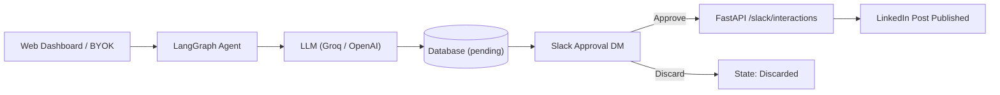

# LinkedIn Post Automation Agent

🌐 **Live Demo:** [poststudio.uzairatiq.app](https://poststudio.uzairatiq.app/)

An automated, human-in-the-loop pipeline that generates technical LinkedIn posts using AI, delivers interactive approval cards to Slack, and publishes approved posts directly to LinkedIn.

**Tech Stack:** LangGraph · Model Context Protocol (MCP) · FastAPI · React 18 · Groq / OpenAI · Slack Block Kit · PostgreSQL / SQLite

<p align="center"></p>

---

## Features

* **AI Post Generation (BYOK)** — Draft high-impact, professional LinkedIn posts using Groq LLMs or bring your own OpenAI-compatible API key, host, and model (OpenAI, OpenRouter, DeepSeek, Together, Ollama) stored securely in browser `localStorage`.
* **Human-in-the-Loop Slack Approvals** — Interactive Slack Block Kit approval cards delivered via direct message with 1-click **Approve** and **Discard** actions.
* **Multi-User Slack Workspace Mapping** — Connect and delink personal Slack accounts with automatic email matching or custom email inputs, paired with instant workspace invite links.
* **Automated LinkedIn Publishing** — Seamless OAuth 2.0 flow with 60-day token auto-refresh and instant post publication upon Slack approval.
* **LangGraph Workflow Orchestration** — Resilient state machine with human interruption points, checkpointer recovery across server restarts, and failure fallback alerts.
* **Model Context Protocol (MCP)** — Native stdio FastMCP servers enabling AI agents to query database records, send Slack messages, and generate/approve posts.
* **Modern Web Dashboard** — Fast React 18 + Vite + Tailwind interface featuring dark/light modes, GSAP micro-animations, post queue status filtering, and live connection indicators.

---

## Architecture Overview



The system uses a strict layered architecture (`routers -> services -> mcp_servers / database`) and supports both LangGraph state machine execution and legacy procedural flows. 

👉 *For node lifecycles, execution modes (`graph` vs `legacy`), and layer separation rules, see the [Architecture & Post Flow Guide](docs/architecture.md).*

---

## Documentation & Where to Find Everything

| Guide | Description |
|---|---|
| 🚀 **[Local Setup & Running Guide](docs/local_setup.md)** | Step-by-step instructions for running the FastAPI backend, React dashboard, and MCP servers locally. |
| 🏗️ **[Architecture & Post Flow Guide](docs/architecture.md)** | Deep dive into LangGraph nodes, execution modes (`graph` vs `legacy`), and layered architecture. |
| 🧪 **[Development & Testing](docs/development.md)** | Running pytest unit tests, test coverage, and benchmark evaluations. |
| 🔗 **[LinkedIn App & OAuth Setup](docs/linkedin_setup.md)** | Creating the LinkedIn Developer app, OAuth 2.0 scopes, and 60-day token lifecycle. |
| 💬 **[Slack App & Interactivity Setup](docs/slack_setup.md)** | Configuring Slack Bot tokens, interactivity webhook URLs, and Block Kit approval cards. |
| 🔌 **[Model Context Protocol (MCP) Guide](project/backend/docs/mcp_servers.md)** | FastMCP stdio server setup, tool specifications, and LLM tool execution. |
| 📡 **[API Endpoints Reference](project/backend/docs/endpoints.md)** | Full route specifications, request/response models, and execution flows. |
| ☁️ **[Cloud Deployment Guide](docs/deployment.md)** | Production deployment on Render, custom domains, and PostgreSQL configuration. |

---

## Repository Structure

<details>
<summary>Full repository structure</summary>

```
mcp-langraph-agent/
├── README.md               # Main project overview, features, and documentation index
├── render.yaml             # Render Blueprint infrastructure configuration
├── .gitignore              # Git ignore rules
├── assets/                 # Media and demo assets
├── project/
│   ├── backend/            # FastAPI, LangGraph workflow, MCP servers, data, and tests
│   │   ├── graphs/         # LangGraph state graph, workflow nodes, and guards
│   │   ├── api/            # API entrypoints
│   │   ├── config/         # App constants and settings
│   │   ├── data/           # SQLite / PostgreSQL persistence and token store
│   │   ├── docs/           # Backend endpoint specs and pipeline documentation
│   │   ├── mcp_servers/    # Stdio MCP servers (database_server, slack_server, linkedin_server)
│   │   ├── observability/  # Langfuse tracing
│   │   ├── routers/        # Modular API routers (auth, posts, slack, frontend)
│   │   ├── services/       # Integrations for Groq, LinkedIn, Slack, Storage, and Approval
│   │   ├── tests/          # Test suite
│   │   ├── main.py         # Unified FastAPI application
│   │   └── requirements.txt# Backend dependencies
│   └── frontend/           # React 18 + Vite + Tailwind dashboard
├── docs/                   # Setup guides and architecture documentation
│   ├── local_setup.md      # Local installation, environment, and execution guide
│   ├── architecture.md     # Architecture, LangGraph state machine, and layers
│   ├── development.md      # Testing and development workflows
│   ├── linkedin_setup.md   # LinkedIn developer credentials guide
│   ├── slack_setup.md       # Slack app, bot token, and interactivity setup
│   └── deployment.md       # Render cloud deployment guide
└── _notes/                 # Plans, prompts, and knowledge graph analysis
```

</details>
