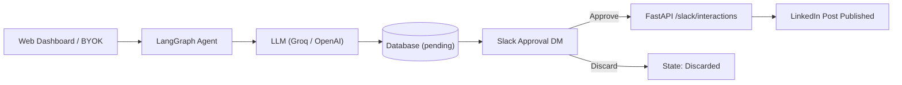

# LinkedIn Post Automation Agent

**Live Demo:** [poststudio.uzairatiq.app](https://poststudio.uzairatiq.app/)

Automated human-in-the-loop pipeline that drafts LinkedIn posts with AI, requests approval via Slack interactive cards, and publishes approved posts directly to LinkedIn.

**Tech Stack:** LangGraph, Model Context Protocol (MCP), FastAPI, React 18, Groq / OpenAI, Slack Block Kit, PostgreSQL / SQLite

<p align="center"></p>

---

## Features

* **AI Post Generation (BYOK):** Generates technical LinkedIn copy using Groq or any OpenAI-compatible provider (OpenAI, OpenRouter, DeepSeek, Ollama) configured in browser localStorage.
* **Human-in-the-Loop Slack Approvals:** Delivers interactive Block Kit approval cards via Slack DM with 1-click Approve and Discard actions.
* **Slack User Mapping:** Matches authors to Slack accounts by email, supports custom Slack email linking/delinking, and provides workspace invite links.
* **Automated LinkedIn Publishing:** Handles OAuth 2.0 flow, 60-day token auto-refresh, and direct UGC post publishing on approval.
* **LangGraph Orchestration:** State graph with pause/interrupt points for human review and persistent checkpoints across restarts.
* **Model Context Protocol (MCP):** Stdio FastMCP tools to draft posts, query database records, and monitor approval decisions.
* **Web Dashboard:** React 18 + Vite interface with light/dark theme, queue status filters, and connection cards.

---

## Architecture Overview



The application uses a layered architecture (`routers -> services -> mcp_servers / storage`) and supports both LangGraph state machine execution and procedural legacy execution.

For node lifecycles, execution modes, and architectural boundaries, see the [Architecture & Post Flow Guide](docs/architecture.md).

---

## Documentation

| Guide | Description |
|---|---|
| **[Local Setup Guide](docs/local_setup.md)** | Run FastAPI backend, React dashboard, and MCP servers locally. |
| **[Architecture & Post Flow Guide](docs/architecture.md)** | LangGraph nodes, execution modes, and layered design. |
| **[Development & Testing Guide](docs/development.md)** | Run pytest test suite and evaluations. |
| **[LinkedIn Setup Guide](docs/linkedin_setup.md)** | Create LinkedIn Developer App, configure OAuth scopes, and tokens. |
| **[Slack Setup Guide](docs/slack_setup.md)** | Configure Slack bot, interactivity webhook, and Block Kit. |
| **[MCP Servers Guide](project/backend/docs/mcp_servers.md)** | FastMCP stdio server setup and tool definitions. |
| **[API Endpoints Reference](project/backend/docs/endpoints.md)** | Route table, request/response schemas, and execution flows. |
| **[Cloud Deployment Guide](docs/deployment.md)** | Production deployment on Render and PostgreSQL configuration. |

---

## Repository Structure

<details>
<summary>Full repository structure</summary>

```
mcp-langraph-agent/
├── README.md               # Main project overview, features, and documentation index
├── render.yaml             # Render Blueprint infrastructure configuration
├── .gitignore              # Git ignore rules
├── assets/                 # Media and demo assets
├── project/
│   ├── backend/            # FastAPI, LangGraph workflow, MCP servers, data, and tests
│   │   ├── graphs/         # LangGraph state graph, workflow nodes, and guards
│   │   ├── api/            # API entrypoints
│   │   ├── config/         # App constants and settings
│   │   ├── data/           # SQLite / PostgreSQL persistence and token store
│   │   ├── docs/           # Backend endpoint specs and pipeline documentation
│   │   ├── mcp_servers/    # Stdio MCP servers (database_server, slack_server, linkedin_server)
│   │   ├── observability/  # Langfuse tracing
│   │   ├── routers/        # Modular API routers (auth, posts, slack, frontend)
│   │   ├── services/       # Integrations for Groq, LinkedIn, Slack, Storage, and Approval
│   │   ├── tests/          # Test suite
│   │   ├── main.py         # Unified FastAPI application
│   │   └── requirements.txt# Backend dependencies
│   └── frontend/           # React 18 + Vite + Tailwind dashboard
├── docs/                   # Setup guides and architecture documentation
│   ├── local_setup.md      # Local installation, environment, and execution guide
│   ├── architecture.md     # Architecture, LangGraph state machine, and layers
│   ├── development.md      # Testing and development workflows
│   ├── linkedin_setup.md   # LinkedIn developer credentials guide
│   ├── slack_setup.md       # Slack app, bot token, and interactivity setup
│   └── deployment.md       # Render cloud deployment guide
└── _notes/                 # Plans, prompts, and knowledge graph analysis
```

</details>
