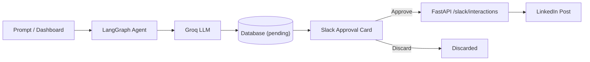

# LinkedIn Post Automation Agent

[](https://render.com/deploy?repo=https://github.com/UzairAtiq/mcp-langraph-agent)

An automated, human-in-the-loop pipeline that generates technical LinkedIn posts using Groq LLMs, delivers interactive approval cards to Slack, and publishes approved posts to LinkedIn.

**Tech Stack:** LangGraph · MCP · FastAPI · React · Groq

<p align="center"></p>

## Features

* **AI Post Generation** — Drafts technical, engaging LinkedIn posts with Groq LLMs and LangGraph workflows.
* **Human-in-the-Loop Slack Approvals** — Interactive Slack Block Kit cards with 1-click Approve and Discard actions.
* **Automated Publishing** — Publishes approved posts to LinkedIn API with automated OAuth 2.0 token refreshes.
* **Web Dashboard** — React 18 + Vite interface to generate posts, review queue status, and manage connections.
* **Model Context Protocol (MCP)** — Stdio MCP servers for AI agents to query database records, send Slack messages, and generate/approve posts.

## Architecture



## Quickstart

```bash
# 1. Clone repository & install dependencies
git clone https://github.com/UzairAtiq/mcp-langraph-agent.git
cd mcp-langraph-agent
python3 -m venv .venv
source .venv/bin/activate
pip install -r project/backend/requirements.txt

# 2. Configure environment variables
cp .env.example .env
```

Fill in the 4 required keys in `.env`:
* `GROQ_API_KEY`
* `SLACK_WEBHOOK_URL`
* `LINKEDIN_CLIENT_ID`
* `LINKEDIN_CLIENT_SECRET`

```bash
# 3. Build frontend & run backend
cd project/frontend && npm install && npm run build
cd ../backend && uvicorn main:app --reload --port 8000
```

Open [http://localhost:8000](http://localhost:8000) to view the dashboard and connect your LinkedIn account.

---

## Running the Application & MCP Servers

### Running the FastAPI Backend
From the repository root with virtual environment activated:
```bash
cd project/backend
uvicorn main:app --reload --port 8000
```
Interactive API documentation is accessible at [http://localhost:8000/docs](http://localhost:8000/docs).

### Running MCP Servers
MCP servers run over stdio and are invoked using Python module execution with `PYTHONPATH=project/backend`:

- **LinkedIn Server** (Post generation, polling, and approval tools):
  ```bash
  PYTHONPATH=project/backend python -m mcp_servers.linkedin_server
  ```
- **Database Server** (Customer lookup tool):
  ```bash
  PYTHONPATH=project/backend python -m mcp_servers.database_server
  ```
- **Slack Server** (Slack notification tool):
  ```bash
  PYTHONPATH=project/backend python -m mcp_servers.slack_server
  ```

---

## Architectural Layers & Coding Rules

The backend adheres to a strict layered architecture:

```
project/
├── backend/
│   ├── routers/                # FastAPI endpoint routers (auth, posts, slack, frontend)
│   ├── services/               # Shared business logic and external integrations
│   │   ├── storage.py          # Single home for PostgreSQL / SQLite / JSON fallback storage
│   │   ├── approval.py         # Decision recording, idempotent execution, and polling loop
│   │   ├── slack_service.py    # Block Kit cards, webhook delivery, card replacement
│   │   ├── groq_service.py     # Groq LLM post drafting (exception-raising style)
│   │   └── linkedin_service.py # LinkedIn identity resolution & UGC publishing (dict return style)
│   ├── mcp_servers/            # Model Context Protocol stdio servers (thin tools)
│   │   ├── database_server.py  # Customer database lookup tool
│   │   ├── slack_server.py     # Slack messaging tool
│   │   └── linkedin_server.py  # Thin tools wrapping services layer
│   └── main.py                 # FastAPI application assembly and lifecycle
```

### 1. Routers Layer (`project/backend/routers/`)
- **What it does:** Handles HTTP requests, parameter validation, authentication redirects, and webhook ingress (`/slack/interactions`, `/posts`, `/linkedin/*`).
- **Rule for adding code:** Keep routes thin. Validate incoming request parameters, delegate immediately to the appropriate service, and return HTTP responses. Never select database backends or invoke external APIs directly inside route handlers. Direction: `routers -> services`.

### 2. Services Layer (`project/backend/services/`)
- **What it does:** Encapsulates all domain logic, external API integrations (Groq, LinkedIn, Slack), decision orchestration, and persistence abstraction.
- **Rule for adding code:** Services must NEVER import from routers, `main.py`, or MCP servers.
  - All storage backend fallback logic (PostgreSQL -> SQLite -> `posts.json`) lives strictly in `storage.py`. No other file may choose a storage backend.
  - Decision state transitions and polling live in `approval.py`.
  - Maintain established error styles: `groq_service` raises exceptions (`ValueError`, `RuntimeError`), while `linkedin_service` returns structured status dictionaries (`{'success': False, 'error': ...}`).
- Detailed reference: see the [Services Layer Guide](project/backend/docs/services.md).

### 3. MCP Servers Layer (`project/backend/mcp_servers/`)
- **What it does:** Exposes FastMCP tools over stdio for LLM agents to draft posts, query customer databases, send Slack alerts, and monitor approval decisions.
- **Rule for adding code:** Keep MCP tools thin. Validate input arguments, call the services layer, and return results. Synchronous waiting tools must enforce timeout bounds using `MAX_APPROVAL_TIMEOUT_SECONDS` (300s). Tools must not implement independent storage access or duplicate service logic.

For complete route definitions, tool catalogs, service responsibilities, and step-by-step flows, see [`project/backend/docs/endpoints.md`](project/backend/docs/endpoints.md).

---

## Documentation

* [API Endpoints & Architecture Overview](project/backend/docs/endpoints.md) — Complete route table, MCP tools, services matrix, and execution flows.
* [Shared Services Layer Guide](project/backend/docs/services.md) — Function reference, dependency hierarchy, error paradigms, and addition rules.
* [Development & Testing](docs/development.md) — Running the LangGraph agent CLI, unit tests, and evaluations.
* [LinkedIn App & OAuth Setup](docs/linkedin_setup.md) — Developer app creation, permissions, and 60-day token lifecycle.
* [Slack App & Interactivity Setup](docs/slack_setup.md) — Webhooks, Block Kit approval cards, and interaction callbacks.
* [Render Cloud Deployment](docs/deployment.md) — 1-click Blueprint deployment and PostgreSQL setup.
* [Project Structure & Architecture](docs/PROJECT_STRUCTURE.md) — Full codebase directory breakdown and file map.

## Repository Structure

<details>
<summary>Full repository structure</summary>

```
mcp-langraph-agent/
├── README.md               # Main project documentation and quickstart
├── render.yaml             # Render Blueprint infrastructure configuration
├── .gitignore              # Git ignore rules
├── assets/                 # Media and demo assets
├── project/
│   ├── backend/            # FastAPI, LangGraph agent, MCP servers, data, and tests
│   │   ├── agent/          # State graph, workflow nodes, and tool adapters
│   │   ├── api/            # API entrypoints
│   │   ├── config/         # App constants and settings
│   │   ├── data/           # SQLite / PostgreSQL persistence and token store
│   │   ├── docs/           # Backend endpoint specs and pipeline documentation
│   │   ├── mcp_servers/    # Stdio MCP servers (database_server, slack_server, linkedin_server)
│   │   ├── observability/  # Langfuse tracing
│   │   ├── routers/        # Modular API routers (auth, posts, slack, frontend)
│   │   ├── services/       # Integrations for Groq, LinkedIn, Slack, Storage, and Approval
│   │   ├── tests/          # Test suite
│   │   ├── main.py         # Unified FastAPI application
│   │   └── requirements.txt# Backend dependencies
│   └── frontend/           # React 18 + Vite + Tailwind dashboard
├── docs/                   # Setup guides and architecture documentation
└── _notes/                 # Plans, prompts, and knowledge graph analysis
```

</details>
