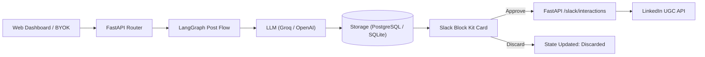
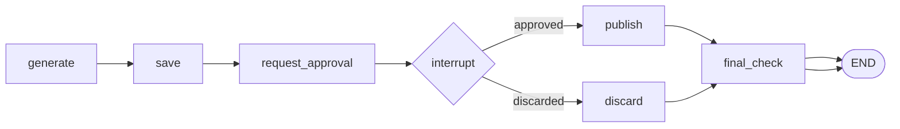

# Architecture & Post Flow Guide

This document details the architectural layers, execution engines, and human-in-the-loop state machine powering the LinkedIn Post Automation Agent.

---

## 1. System Architecture Overview

The system bridges frontend user intent, AI post drafting, human review, and social publishing:



---

## 2. Post Flow Execution Modes

The backend supports two interchangeable execution engines configured via the `POST_FLOW_MODE` environment variable:

- **`graph` (Default & Recommended)**: LangGraph state machine with explicit workflow nodes, human-in-the-loop pause/interrupt points, checkpointer resilience across server reboots, and thin MCP tool integration.
- **`legacy`**: Procedural pipeline that executes generation, storage, and Slack notification sequentially without graph checkpoints.

### LangGraph State Machine Workflow



### Graph Node Lifecycles:
1. **`generate`**: Resolves prompt topic and calls LLM (Groq or user-supplied BYOK OpenAI-compatible key/host) to craft clean, engaging LinkedIn copy.
2. **`save`**: Persists post record to database with `pending` status and binds ownership to the user's LinkedIn identity (`owner_sub`).
3. **`request_approval`**: Queries author's Slack member ID and sends an interactive Block Kit card with Approve and Discard buttons.
4. **`interrupt`**: Halts graph execution until an external approval decision arrives via Slack interaction webhook or dashboard.
5. **`publish`**: On approval, retrieves valid LinkedIn OAuth access token (auto-refreshing if expired) and publishes directly to the LinkedIn UGC API.
6. **`discard`**: On discard, updates post status to `discarded` and updates the Slack Block Kit card in place.
7. **`final_check`**: Records completion timestamp and validates state consistency.

---

## 3. Layered Architecture & Separation of Concerns

The backend follows a strict layered design:

```
project/backend/
├── routers/        # Thin HTTP ingress, validation, and session cookies
├── services/       # Core business logic, LLM providers, and storage abstractions
├── graphs/         # LangGraph state machine definitions, nodes, and setup
└── mcp_servers/    # Model Context Protocol stdio tools
```

### Layer 1: Routers (`project/backend/routers/`)
- **Responsibility**: Ingress validation, HTTP headers, authentication checks, and session cookie management (`/posts`, `/linkedin/*`, `/slack/*`).
- **Rule**: Routers must stay thin. They validate parameters, delegate immediately to the services layer, and return HTTP responses. Routers never make direct database queries or call external APIs directly.
- *Detailed spec: [Routers Layer Guide](file:///Users/uzair/Developer/mcp-langraph-agent/project/backend/docs/routers.md)*

### Layer 2: Services (`project/backend/services/`)
- **Responsibility**: Encapsulates external integrations (Groq, OpenAI, LinkedIn, Slack), decision state transitions, and persistent storage.
- **Rule**: Services never import from routers or MCP servers.
  - All storage logic lives in [`storage.py`](file:///Users/uzair/Developer/mcp-langraph-agent/project/backend/services/storage.py) with automatic multi-tier fallback (PostgreSQL -> SQLite -> JSON).
  - Decision state transitions and approval polling live in [`approval.py`](file:///Users/uzair/Developer/mcp-langraph-agent/project/backend/services/approval.py).
  - Error style: `groq_service` raises exceptions (`ValueError`, `RuntimeError`), while `linkedin_service` returns structured status dictionaries (`{'success': False, 'error': ...}`).
- *Detailed spec: [Services Layer Guide](file:///Users/uzair/Developer/mcp-langraph-agent/project/backend/docs/services.md)*

### Layer 3: MCP Servers (`project/backend/mcp_servers/`)
- **Responsibility**: Exposes FastMCP tools over stdio for LLM agents to draft posts, query databases, send Slack alerts, and monitor approval decisions.
- **Rule**: MCP tools are thin adapters wrapping the services layer. Synchronous polling tools enforce timeout bounds using `MAX_APPROVAL_TIMEOUT_SECONDS` (300s).
- *Detailed spec: [MCP Servers Guide](file:///Users/uzair/Developer/mcp-langraph-agent/project/backend/docs/mcp_servers.md)*

---

## 4. Multi-User Authentication & Storage

- **User Identity**: Users authenticate with LinkedIn OAuth 2.0. Their sub/URN (e.g. `urn:li:person:...`) acts as their unique user key.
- **Sessions**: Authenticated sessions are tracked server-side in the `sessions` table and secured via an HTTP-only `session_id` cookie.
- **Slack Mapping**: Users can link their Slack account by matching their email address in the admin Slack workspace. Approval requests are delivered as direct messages (DMs) to the author's Slack account.
- **BYOK (Bring Your Own Key)**: Custom LLM keys, hosts, and models are stored exclusively in the user's browser `localStorage` and sent over HTTPS headers (`X-LLM-API-Key`, `X-LLM-Base-URL`, `X-LLM-Model`), ensuring private credentials are never written to the server's database.
