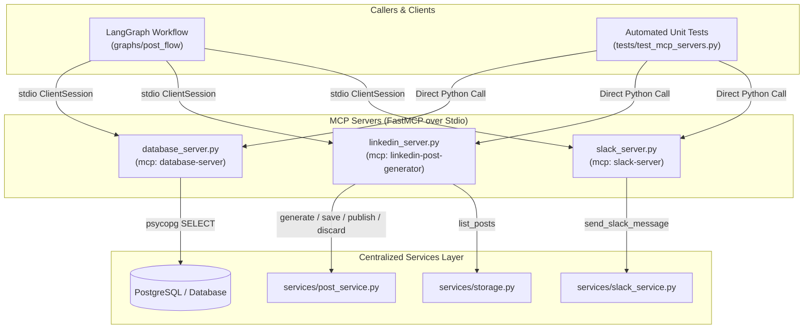
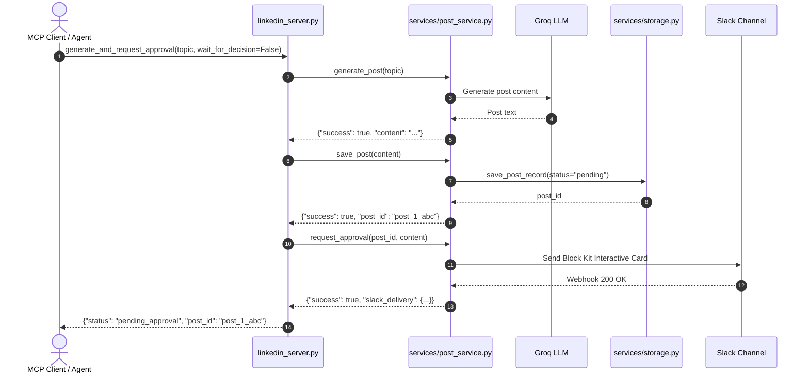

# Model Context Protocol (MCP) Servers Layer

The MCP servers layer provides standardized, tool-based interfaces implementing Anthropic's Model Context Protocol (MCP) over `stdio` transport using `FastMCP`. These servers expose database lookups, post generation workflows, and Slack dispatch capabilities as structured tools callable by LangGraph agents and automated test suites.

## 1. Folder Structure

```
project/backend/mcp_servers/
├── __init__.py                 # Package marker
├── database_server.py          # Primary customer database lookup MCP tool
├── db_server.py                # Compatibility alias delegating to database_server
├── linkedin_server.py          # Primary LinkedIn post lifecycle and approval MCP tools
├── linkedin_post_generator.py  # Compatibility alias delegating to linkedin_server
└── slack_server.py             # Slack notification dispatch MCP tool
```

---

## 2. Architecture & Protocol Flow

The MCP servers act as lightweight protocol adapters between MCP client sessions and centralized backend services.



---

## 3. Tools Reference

### Primary Tools

| Tool Name | Server File | Parameters | Returns | Backing Logic / Purpose |
| :--- | :--- | :--- | :--- | :--- |
| [`lookup_customer`](file:///Users/uzair/Developer/mcp-langraph-agent/project/backend/mcp_servers/database_server.py#L14) | [`database_server.py`](file:///Users/uzair/Developer/mcp-langraph-agent/project/backend/mcp_servers/database_server.py) | `customer_id: int` | `dict[str, Any]` | Connects to PostgreSQL via `psycopg` and fetches customer row (`id`, `name`, `email`, `company`, `status`). Returns `{"error": ...}` if absent or unconfigured. |
| [`generate_post`](file:///Users/uzair/Developer/mcp-langraph-agent/project/backend/mcp_servers/linkedin_server.py#L25) | [`linkedin_server.py`](file:///Users/uzair/Developer/mcp-langraph-agent/project/backend/mcp_servers/linkedin_server.py) | `topic: str` | `dict[str, Any]` | Validates credentials and generates LinkedIn post content using Groq LLM via `post_service.generate_post`. |
| [`save_post`](file:///Users/uzair/Developer/mcp-langraph-agent/project/backend/mcp_servers/linkedin_server.py#L47) | [`linkedin_server.py`](file:///Users/uzair/Developer/mcp-langraph-agent/project/backend/mcp_servers/linkedin_server.py) | `content: str`, `post_id: str = ""` | `dict[str, Any]` | Persists post draft with `pending` status into database or JSON storage via `post_service.save_post`. |
| [`request_approval`](file:///Users/uzair/Developer/mcp-langraph-agent/project/backend/mcp_servers/linkedin_server.py#L70) | [`linkedin_server.py`](file:///Users/uzair/Developer/mcp-langraph-agent/project/backend/mcp_servers/linkedin_server.py) | `post_id: str`, `content: str` | `dict[str, Any]` | Sends Block Kit interactive review card with Approve/Discard buttons to Slack via `post_service.request_approval`. |
| [`publish_post`](file:///Users/uzair/Developer/mcp-langraph-agent/project/backend/mcp_servers/linkedin_server.py#L93) | [`linkedin_server.py`](file:///Users/uzair/Developer/mcp-langraph-agent/project/backend/mcp_servers/linkedin_server.py) | `post_id: str` | `dict[str, Any]` | Publishes an approved post to LinkedIn UGC REST API and updates status to `published` via `post_service.publish_post`. |
| [`discard_post`](file:///Users/uzair/Developer/mcp-langraph-agent/project/backend/mcp_servers/linkedin_server.py#L115) | [`linkedin_server.py`](file:///Users/uzair/Developer/mcp-langraph-agent/project/backend/mcp_servers/linkedin_server.py) | `post_id: str` | `dict[str, Any]` | Marks post status as `discarded` and updates original Slack card to reflect cancellation via `post_service.discard_post`. |
| [`get_post`](file:///Users/uzair/Developer/mcp-langraph-agent/project/backend/mcp_servers/linkedin_server.py#L137) | [`linkedin_server.py`](file:///Users/uzair/Developer/mcp-langraph-agent/project/backend/mcp_servers/linkedin_server.py) | `post_id: str` | `dict[str, Any]` | Retrieves record by ID with sanitized/masked access token via `post_service.get_post`. |
| [`send_slack_message`](file:///Users/uzair/Developer/mcp-langraph-agent/project/backend/mcp_servers/slack_server.py#L12) | [`slack_server.py`](file:///Users/uzair/Developer/mcp-langraph-agent/project/backend/mcp_servers/slack_server.py) | `message: str` | `dict[str, Any]` | Posts plain text notification directly to configured Slack incoming webhook via `slack_service.send_slack_message`. |

### Composite & Compatibility Tools

| Tool Name | Server File | Parameters | Returns | Description |
| :--- | :--- | :--- | :--- | :--- |
| [`generate_and_request_approval`](file:///Users/uzair/Developer/mcp-langraph-agent/project/backend/mcp_servers/linkedin_server.py#L189) | [`linkedin_server.py`](file:///Users/uzair/Developer/mcp-langraph-agent/project/backend/mcp_servers/linkedin_server.py) | `topic: str`, `wait_for_decision: bool = False`, `timeout_seconds: int = 60` | `dict[str, Any]` | Generates post, saves to storage, and delivers Slack card. If `wait_for_decision=True`, polls storage synchronously up to timeout for human review. |
| [`wait_for_approval_decision`](file:///Users/uzair/Developer/mcp-langraph-agent/project/backend/mcp_servers/linkedin_server.py#L221) | [`linkedin_server.py`](file:///Users/uzair/Developer/mcp-langraph-agent/project/backend/mcp_servers/linkedin_server.py) | `post_id: str`, `timeout_seconds: int = 60` | `dict[str, Any]` | Polls storage every 2 seconds for Slack button clicks, executing approval/discard upon decision detection. |
| [`approve_or_discard_post_directly`](file:///Users/uzair/Developer/mcp-langraph-agent/project/backend/mcp_servers/linkedin_server.py#L227) | [`linkedin_server.py`](file:///Users/uzair/Developer/mcp-langraph-agent/project/backend/mcp_servers/linkedin_server.py) | `post_id: str`, `action: str = "approve"` | `dict[str, Any]` | Directly triggers publication or disposal without waiting for Slack user interaction. |
| [`get_post_details`](file:///Users/uzair/Developer/mcp-langraph-agent/project/backend/mcp_servers/linkedin_server.py#L160) | [`linkedin_server.py`](file:///Users/uzair/Developer/mcp-langraph-agent/project/backend/mcp_servers/linkedin_server.py) | `post_id: str` | `dict[str, Any]` | Backwards-compatibility alias for `get_post`. |
| [`list_all_generated_posts`](file:///Users/uzair/Developer/mcp-langraph-agent/project/backend/mcp_servers/linkedin_server.py#L166) | [`linkedin_server.py`](file:///Users/uzair/Developer/mcp-langraph-agent/project/backend/mcp_servers/linkedin_server.py) | `status_filter: str = ""` | `dict[str, Any]` | Fetches all stored records via `storage.list_posts`, sanitizes tokens, and returns `{"total_count": int, "posts": [...]}`. |

---

## 4. Execution Patterns

### 1. Thin Delegation Rule
MCP server files must remain thin protocol wrappers:
- **No business logic in MCP servers**: All validation, Groq prompting, LinkedIn REST calls, and Slack Block Kit construction reside strictly in `services/`.
- **Exception Boundary**: MCP tools catch errors and return structured dictionaries (`{"success": False, "error": ...}`) rather than leaking raw Python exceptions across the MCP transport boundary.

### 2. Transport & Invocation Modes
- **MCP Stdio Server Execution**: When run directly (`python -m mcp_servers.linkedin_server`), FastMCP listens on standard input/output (`stdio`) using JSON-RPC.
- **Direct Python Invocation**: During automated test execution or in-process runs, tool functions can be directly imported and invoked as normal Python functions (e.g. `lookup_customer(1)`).

---

## 5. Sequence: Composite Tool Workflow



---

## 6. Guidelines for Adding New MCP Tools

1. **Where to place logic**:
   - Implement core operations in `services/` first.
   - Decorate thin forwarding functions with `@mcp.tool()` inside the appropriate server file.
2. **Schema & Docstrings**:
   - Provide type annotations on all parameters and return types.
   - Include complete Google-style docstrings with `Purpose`, `Steps`, `Returns`, and `Raises` sections for automatic MCP tool parameter schema discovery.
3. **Compatibility**:
   - When renaming or restructuring tools, preserve legacy aliases in compatibility modules (`db_server.py`, `linkedin_post_generator.py`) to prevent breaking existing integrations.
