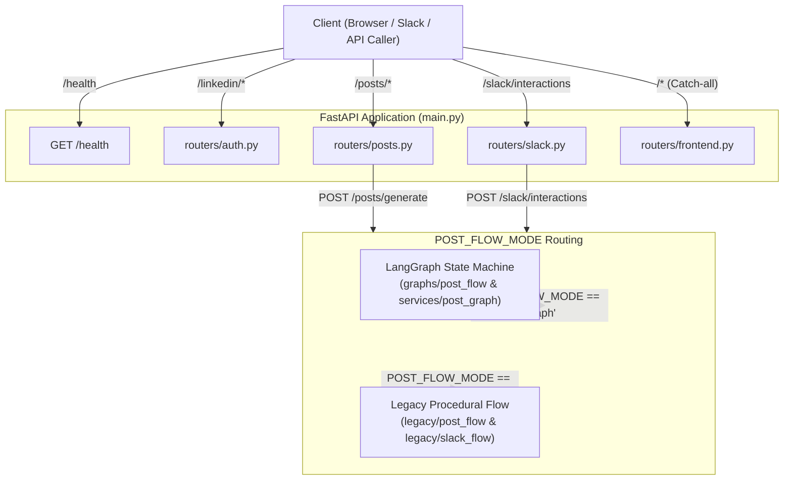
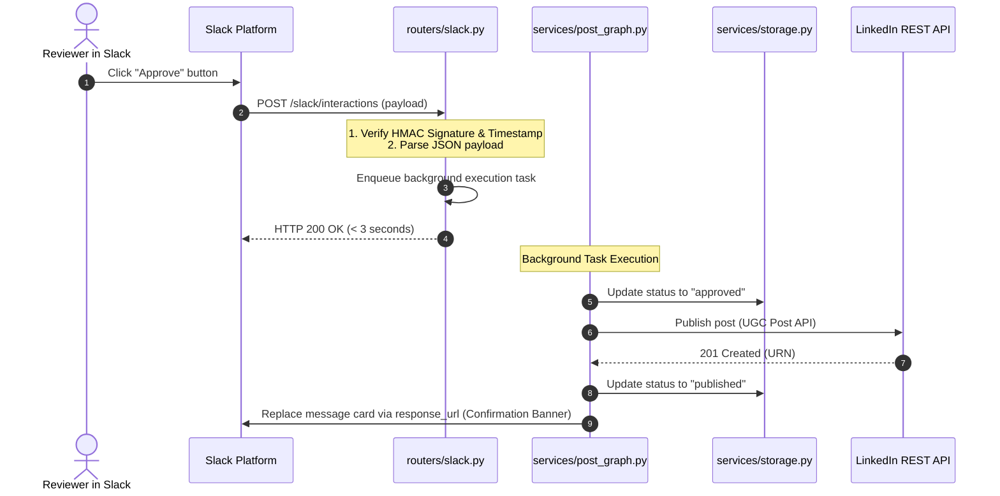

# API Routers Layer

The routers layer defines the external HTTP endpoints for the application using FastAPI `APIRouter` modules. It manages LinkedIn OAuth 2.0 authentication flows, Slack interactive webhook callbacks, LinkedIn post CRUD management, and single-page application (SPA) frontend asset delivery.

## 1. Folder Structure

```
project/backend/routers/
├── __init__.py           # Package marker
├── auth.py               # LinkedIn OAuth 2.0 authorization, callback, status, and token refresh
├── frontend.py           # Dashboard HTML delivery and SPA catch-all client-side routing fallback
├── posts.py              # LinkedIn post generation, listing, retrieval, and deletion
└── slack.py              # Slack interactive webhook verification, decision logging, and background dispatch
```

---

## 2. Router & Endpoint Reference

### Authentication Router ([`routers/auth.py`](file:///Users/uzair/Developer/mcp-langraph-agent/project/backend/routers/auth.py))

| Endpoint / Function | Method | Path | Request Inputs | Response Output | Description & Flow |
| :--- | :--- | :--- | :--- | :--- | :--- |
| [`linkedin_login`](file:///Users/uzair/Developer/mcp-langraph-agent/project/backend/routers/auth.py) | `GET` | `/linkedin/login` | None | `RedirectResponse` (302) | Generates cryptographically secure 32-byte CSRF `state`, sets temporary `HttpOnly` state cookie (`linkedin_oauth_state`), and redirects user to LinkedIn's authorization endpoint with requested scopes (`openid profile w_member_social email`). |
| [`linkedin_callback`](file:///Users/uzair/Developer/mcp-langraph-agent/project/backend/routers/auth.py) | `GET` | `/linkedin/callback`<br>`/callback` | Query: `code`, `state`, `error`, `error_description` | `HTMLResponse` | Verifies `state` query param matches `linkedin_oauth_state` cookie, clears state cookie, exchanges auth code for tokens, resolves author person URN (`/v2/userinfo`), persists credentials via `services.storage.save_linkedin_token`, creates a server-side session, and sets an `HttpOnly` `session_id` cookie before rendering `callback.html`. |
| [`linkedin_logout`](file:///Users/uzair/Developer/mcp-langraph-agent/project/backend/routers/auth.py) | `GET`, `POST` | `/linkedin/logout` | Cookie: `session_id` | `RedirectResponse` (302) | Revokes user session from PostgreSQL/SQLite, clears `session_id` cookie on response, and redirects to dashboard. |
| [`linkedin_status`](file:///Users/uzair/Developer/mcp-langraph-agent/project/backend/routers/auth.py) | `GET` | `/linkedin/status` | Cookie: `session_id` (optional) | `dict[str, Any]` | Reads active user session from cookie, queries token record for that user (with fallback to default), verifies expiration, and returns masked token preview, person URN, and `expired` status flag. |
| [`refresh_token_endpoint`](file:///Users/uzair/Developer/mcp-langraph-agent/project/backend/routers/auth.py) | `POST` | `/linkedin/refresh` | Cookie: `session_id` (optional) | `dict[str, Any]` | Invokes `services.storage.refresh_linkedin_access_token` for the authenticated user session (or default) using stored refresh token without requiring re-login. Raises 400 Bad Request on failure. |

---

### Posts Router ([`routers/posts.py`](file:///Users/uzair/Developer/mcp-langraph-agent/project/backend/routers/posts.py))

| Endpoint / Function | Method | Path | Request Inputs | Response Output | Description & Flow |
| :--- | :--- | :--- | :--- | :--- | :--- |
| [`get_all_posts`](file:///Users/uzair/Developer/mcp-langraph-agent/project/backend/routers/posts.py#L28) | `GET` | `/posts` | Query: `status_filter: str | None` | `dict[str, Any]` or `HTMLResponse` | Returns list of stored posts with sensitive tokens masked. If requested directly by a browser (`Accept: text/html`), returns the SPA React dashboard instead of JSON. |
| [`get_single_post`](file:///Users/uzair/Developer/mcp-langraph-agent/project/backend/routers/posts.py#L74) | `GET` | `/posts/{post_id}` | Path: `post_id: str` | `dict[str, Any]` | Fetches single post by unique ID with masked tokens. Raises HTTP 404 if record is absent. |
| [`delete_post_endpoint`](file:///Users/uzair/Developer/mcp-langraph-agent/project/backend/routers/posts.py#L108) | `DELETE` | `/posts/{post_id}` | Path: `post_id: str` | `dict[str, Any]` | Confirms post existence and permanently removes record from persistent storage. Raises HTTP 404 if post does not exist. |
| [`generate_post_endpoint`](file:///Users/uzair/Developer/mcp-langraph-agent/project/backend/routers/posts.py#L143) | `POST` | `/posts/generate` | Query: `topic: str` | `dict[str, Any]` | Generates post and sends interactive Slack review card. Routes to LangGraph flow (`services.post_graph.start_post_flow`) when `POST_FLOW_MODE=graph` or legacy flow (`legacy.post_flow.run_legacy_post_flow`) when `POST_FLOW_MODE=legacy`. |

---

### Slack Router ([`routers/slack.py`](file:///Users/uzair/Developer/mcp-langraph-agent/project/backend/routers/slack.py))

| Endpoint / Function | Method | Path | Request Inputs | Response Output | Description & Flow |
| :--- | :--- | :--- | :--- | :--- | :--- |
| [`handle_slack_interactions`](file:///Users/uzair/Developer/mcp-langraph-agent/project/backend/routers/slack.py#L108) | `POST` | `/slack/interactions` | Form payload: `payload: str` (URL-encoded JSON) | `Response` (HTTP 200) | Validates HMAC signature, extracts clicked action (`approve` or `discard`), and dispatches to background tasks. Resumes LangGraph workflow when in graph mode or processes legacy background flow when in legacy mode. Meets Slack's strict 3-second acknowledgment deadline. |
| [`verify_slack_signature`](file:///Users/uzair/Developer/mcp-langraph-agent/project/backend/routers/slack.py#L27) | Helper | — | `Request`, `raw_body: bytes` | `None` | Checks `X-Slack-Request-Timestamp` (< 5 minutes freshness) and validates `X-Slack-Signature` using `SLACK_SIGNING_SECRET` and HMAC-SHA256. Raises HTTP 401 if invalid. |

---

### Frontend Router ([`routers/frontend.py`](file:///Users/uzair/Developer/mcp-langraph-agent/project/backend/routers/frontend.py))

| Endpoint / Function | Method | Path | Request Inputs | Response Output | Description & Flow |
| :--- | :--- | :--- | :--- | :--- | :--- |
| [`root_dashboard`](file:///Users/uzair/Developer/mcp-langraph-agent/project/backend/routers/frontend.py#L13) | `GET` | `/` | None | `HTMLResponse` | Renders root dashboard view from built React SPA (`frontend/dist/index.html`) or static fallback page. |
| [`spa_fallback`](file:///Users/uzair/Developer/mcp-langraph-agent/project/backend/routers/frontend.py#L36) | `GET` | `/{full_path:path}` | Path: `full_path: str` | `HTMLResponse` or 404 | Catch-all handler for client-side React SPA routing. Rejects reserved system prefixes (`health`, `linkedin`, `slack`, `posts`, `docs`, `redoc`, `openapi.json`, `assets`, `static`) with HTTP 404 while serving `index.html` for valid client routes. |

---

## 3. Request Flow & Routing Architecture



---

## 4. Security & Middleware Mechanics

1. **Slack Webhook Signature Verification**:
   - Computes expected signature `v0={hmac_sha256(secret, "v0:{timestamp}:{raw_body}")}`.
   - Enforces timestamp freshness within **300 seconds** (5 minutes) to defeat replay attacks.
   - Uses constant-time string comparison (`hmac.compare_digest`) to prevent timing side-channels.
2. **LinkedIn OAuth CSRF Prevention & State Cookie Validation**:
   - Generates a 32-byte cryptographically secure random `state` parameter (`secrets.token_urlsafe(32)`) on each `/linkedin/login` redirect.
   - Sets a short-lived `linkedin_oauth_state` cookie (`HttpOnly=True`, `SameSite=Lax`, `Secure` over HTTPS, `max_age=600`).
   - Callback strictly validates that incoming query `state` exactly matches the cookie, clearing the cookie and rejecting mismatches with HTTP 403 Forbidden.
   - Uses dynamic host detection (`get_effective_redirect_uri`) to ensure valid callback URLs behind reverse proxies (Render, ngrok).
3. **Session Management & Cookie Isolation**:
   - Upon successful OAuth consent, generates an unguessable 32-byte `session_id`.
   - Persists the session in the `sessions` table mapping `session_id` -> user's `person_urn` with expiration (`expires_at`).
   - Issues an `HttpOnly`, `SameSite="Lax"`, `Secure` (over HTTPS) `session_id` cookie to the browser.
   - The user's internal `sub` or `person_urn` is never stored in client-side cookies or accessible via client JavaScript.
   - `/linkedin/logout` deletes the server-side session and destroys the browser cookie.
4. **Token Encryption at Rest**:
   - OAuth access and refresh tokens are encrypted using AES-128-CBC symmetric encryption via Fernet (`services.crypto.encrypt_token`) before persisting to database tables (`linkedin_tokens` and `posts.access_token`).
5. **SPA Prefix Isolation**:
   - `frontend.py` prevents static routing fallbacks from masking non-existent API routes by rejecting reserved prefixes with an explicit 404 Not Found response.

---

## 5. Sequence: Slack Interaction Webhook



---

## 6. Guidelines for Adding New Routers or Endpoints

1. **Router Registration**:
   - Always instantiate `router = APIRouter(tags=["..."])`.
   - Register new routers in [`main.py`](file:///Users/uzair/Developer/mcp-langraph-agent/project/backend/main.py) **before** `frontend_router` so that the SPA catch-all route does not intercept new API paths.
2. **Separation of Concerns**:
   - Keep routers focused on HTTP transport: validate parameters, inspect headers, handle HTTP status codes, and call into `services/`.
   - Do not write database SQL or third-party HTTP client calls directly in router route functions.
3. **Documentation**:
   - Provide explicit docstrings with `Purpose`, `Steps`, `Returns`, and `Raises`.
   - Update [`endpoints.md`](file:///Users/uzair/Developer/mcp-langraph-agent/project/backend/docs/endpoints.md) and [`routers.md`](file:///Users/uzair/Developer/mcp-langraph-agent/project/backend/docs/routers.md) whenever new endpoints or query parameters are added.
