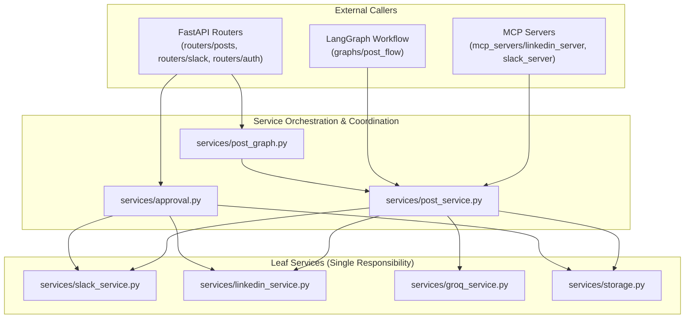
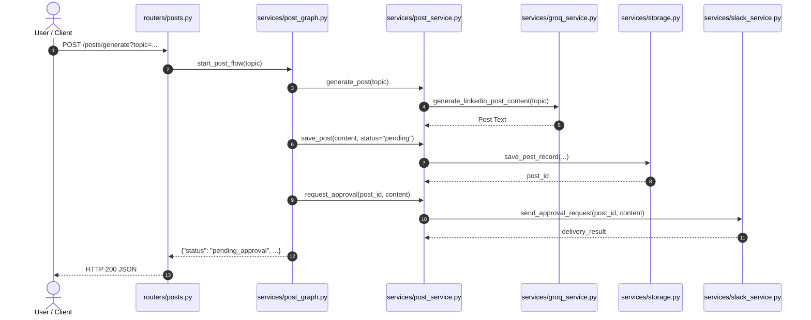

# Shared Services Layer

The services layer encapsulates business logic, persistence abstraction, and external API integrations for the LinkedIn Post Automation platform.

## 1. Folder Structure

```
project/backend/services/
├── __init__.py           # Package marker and services layer docstring
├── approval.py           # Human-in-the-loop decision recording, idempotent publishing, and polling
├── groq_service.py       # Groq LLM prompt construction and post generation (raises exceptions)
├── linkedin_service.py   # LinkedIn member URN resolution and UGC publishing (returns result dict)
├── post_graph.py         # LangGraph post flow start and resume interface
├── post_service.py       # Centralized post business logic and single source of truth
├── slack_service.py      # Slack Block Kit message formatting, webhook delivery, and card replacement
└── storage.py            # Centralized persistence with PostgreSQL, SQLite, and JSON fallbacks
```

---

## 2. Functions Reference

| Function | File | Purpose | Who Calls It |
| :--- | :--- | :--- | :--- |
| [`start_post_flow`](file:///Users/uzair/Developer/mcp-langraph-agent/project/backend/services/post_graph.py) | [`post_graph.py`](file:///Users/uzair/Developer/mcp-langraph-agent/project/backend/services/post_graph.py) | Executes graph post flow until Slack approval interruption | [`routers/posts.py`](file:///Users/uzair/Developer/mcp-langraph-agent/project/backend/routers/posts.py) |
| [`resume_post_flow`](file:///Users/uzair/Developer/mcp-langraph-agent/project/backend/services/post_graph.py) | [`post_graph.py`](file:///Users/uzair/Developer/mcp-langraph-agent/project/backend/services/post_graph.py) | Resumes interrupted graph flow with human approval decision | [`routers/slack.py`](file:///Users/uzair/Developer/mcp-langraph-agent/project/backend/routers/slack.py) |
| [`process_graph_slack_interaction`](file:///Users/uzair/Developer/mcp-langraph-agent/project/backend/services/post_graph.py) | [`post_graph.py`](file:///Users/uzair/Developer/mcp-langraph-agent/project/backend/services/post_graph.py) | Extracts Slack action and enqueues `resume_post_flow` in background | [`routers/slack.py`](file:///Users/uzair/Developer/mcp-langraph-agent/project/backend/routers/slack.py) |
| [`set_post_graph_runtime`](file:///Users/uzair/Developer/mcp-langraph-agent/project/backend/services/post_graph.py) | [`post_graph.py`](file:///Users/uzair/Developer/mcp-langraph-agent/project/backend/services/post_graph.py) | Stores compiled graph, MCP client, and checkpointer in runtime holder | [`main.py`](file:///Users/uzair/Developer/mcp-langraph-agent/project/backend/main.py) |
| [`get_post_graph_runtime`](file:///Users/uzair/Developer/mcp-langraph-agent/project/backend/services/post_graph.py) | [`post_graph.py`](file:///Users/uzair/Developer/mcp-langraph-agent/project/backend/services/post_graph.py) | Retrieves active graph runtime components for flow execution | [`services/post_graph.py`](file:///Users/uzair/Developer/mcp-langraph-agent/project/backend/services/post_graph.py) |
| [`generate_post`](file:///Users/uzair/Developer/mcp-langraph-agent/project/backend/services/post_service.py) | [`post_service.py`](file:///Users/uzair/Developer/mcp-langraph-agent/project/backend/services/post_service.py) | Validates topic and generates post content via Groq LLM | [`mcp_servers/linkedin_server.py`](file:///Users/uzair/Developer/mcp-langraph-agent/project/backend/mcp_servers/linkedin_server.py) |
| [`save_post`](file:///Users/uzair/Developer/mcp-langraph-agent/project/backend/services/post_service.py) | [`post_service.py`](file:///Users/uzair/Developer/mcp-langraph-agent/project/backend/services/post_service.py) | Persists post record with pending status in active storage | [`mcp_servers/linkedin_server.py`](file:///Users/uzair/Developer/mcp-langraph-agent/project/backend/mcp_servers/linkedin_server.py) |
| [`request_approval`](file:///Users/uzair/Developer/mcp-langraph-agent/project/backend/services/post_service.py) | [`post_service.py`](file:///Users/uzair/Developer/mcp-langraph-agent/project/backend/services/post_service.py) | Sends interactive Slack card for human review | [`mcp_servers/linkedin_server.py`](file:///Users/uzair/Developer/mcp-langraph-agent/project/backend/mcp_servers/linkedin_server.py) |
| [`publish_post`](file:///Users/uzair/Developer/mcp-langraph-agent/project/backend/services/post_service.py) | [`post_service.py`](file:///Users/uzair/Developer/mcp-langraph-agent/project/backend/services/post_service.py) | Publishes approved post to LinkedIn API and updates status | [`mcp_servers/linkedin_server.py`](file:///Users/uzair/Developer/mcp-langraph-agent/project/backend/mcp_servers/linkedin_server.py) |
| [`discard_post`](file:///Users/uzair/Developer/mcp-langraph-agent/project/backend/services/post_service.py) | [`post_service.py`](file:///Users/uzair/Developer/mcp-langraph-agent/project/backend/services/post_service.py) | Discards rejected post and updates Slack card status | [`mcp_servers/linkedin_server.py`](file:///Users/uzair/Developer/mcp-langraph-agent/project/backend/mcp_servers/linkedin_server.py) |
| [`get_post`](file:///Users/uzair/Developer/mcp-langraph-agent/project/backend/services/post_service.py) | [`post_service.py`](file:///Users/uzair/Developer/mcp-langraph-agent/project/backend/services/post_service.py) | Fetches post record by ID and masks access tokens | [`mcp_servers/linkedin_server.py`](file:///Users/uzair/Developer/mcp-langraph-agent/project/backend/mcp_servers/linkedin_server.py) |
| [`notify_failure`](file:///Users/uzair/Developer/mcp-langraph-agent/project/backend/services/post_service.py) | [`post_service.py`](file:///Users/uzair/Developer/mcp-langraph-agent/project/backend/services/post_service.py) | Posts failure alert to Slack channel without retries | [`graphs/post_flow/nodes.py`](file:///Users/uzair/Developer/mcp-langraph-agent/project/backend/graphs/post_flow/nodes.py), [`services/post_graph.py`](file:///Users/uzair/Developer/mcp-langraph-agent/project/backend/services/post_graph.py) |
| [`record_slack_decision`](file:///Users/uzair/Developer/mcp-langraph-agent/project/backend/services/approval.py#L16) | [`approval.py`](file:///Users/uzair/Developer/mcp-langraph-agent/project/backend/services/approval.py) | Validates post and records user action (approved/discarded) in storage | [`routers/slack.py`](file:///Users/uzair/Developer/mcp-langraph-agent/project/backend/routers/slack.py), [`mcp_servers/linkedin_server.py`](file:///Users/uzair/Developer/mcp-langraph-agent/project/backend/mcp_servers/linkedin_server.py) |
| [`execute_post_decision`](file:///Users/uzair/Developer/mcp-langraph-agent/project/backend/services/approval.py#L76) | [`approval.py`](file:///Users/uzair/Developer/mcp-langraph-agent/project/backend/services/approval.py) | Idempotently executes post publication or disposal and updates Slack card | [`routers/slack.py`](file:///Users/uzair/Developer/mcp-langraph-agent/project/backend/routers/slack.py), [`approval.wait_for_decision`](file:///Users/uzair/Developer/mcp-langraph-agent/project/backend/services/approval.py#L196), [`mcp_servers/linkedin_server.py`](file:///Users/uzair/Developer/mcp-langraph-agent/project/backend/mcp_servers/linkedin_server.py) |
| [`wait_for_decision`](file:///Users/uzair/Developer/mcp-langraph-agent/project/backend/services/approval.py#L196) | [`approval.py`](file:///Users/uzair/Developer/mcp-langraph-agent/project/backend/services/approval.py) | Polls storage every 2s for decision up to capped timeout, executing upon decision | [`mcp_servers/linkedin_server.py`](file:///Users/uzair/Developer/mcp-langraph-agent/project/backend/mcp_servers/linkedin_server.py) |
| [`generate_linkedin_post_content`](file:///Users/uzair/Developer/mcp-langraph-agent/project/backend/services/groq_service.py#L11) | [`groq_service.py`](file:///Users/uzair/Developer/mcp-langraph-agent/project/backend/services/groq_service.py) | Requests Groq LLM completion for requested topic with Langfuse tracing | [`routers/posts.py`](file:///Users/uzair/Developer/mcp-langraph-agent/project/backend/routers/posts.py), [`mcp_servers/linkedin_server.py`](file:///Users/uzair/Developer/mcp-langraph-agent/project/backend/mcp_servers/linkedin_server.py) |
| [`fetch_linkedin_person_urn`](file:///Users/uzair/Developer/mcp-langraph-agent/project/backend/services/linkedin_service.py#L14) | [`linkedin_service.py`](file:///Users/uzair/Developer/mcp-langraph-agent/project/backend/services/linkedin_service.py) | Resolves author person URN via `/v2/userinfo` or `/v2/me` endpoints | [`routers/auth.py`](file:///Users/uzair/Developer/mcp-langraph-agent/project/backend/routers/auth.py), [`approval.execute_post_decision`](file:///Users/uzair/Developer/mcp-langraph-agent/project/backend/services/approval.py#L76), [`mcp_servers/linkedin_server.py`](file:///Users/uzair/Developer/mcp-langraph-agent/project/backend/mcp_servers/linkedin_server.py) |
| [`publish_post_to_linkedin`](file:///Users/uzair/Developer/mcp-langraph-agent/project/backend/services/linkedin_service.py#L53) | [`linkedin_service.py`](file:///Users/uzair/Developer/mcp-langraph-agent/project/backend/services/linkedin_service.py) | Submits UGC post payload to LinkedIn REST API | [`approval.execute_post_decision`](file:///Users/uzair/Developer/mcp-langraph-agent/project/backend/services/approval.py#L76) |
| [`build_approval_blocks`](file:///Users/uzair/Developer/mcp-langraph-agent/project/backend/services/slack_service.py#L20) | [`slack_service.py`](file:///Users/uzair/Developer/mcp-langraph-agent/project/backend/services/slack_service.py) | Builds interactive Slack Block Kit JSON components with buttons | [`slack_service.send_approval_request`](file:///Users/uzair/Developer/mcp-langraph-agent/project/backend/services/slack_service.py#L98) |
| [`send_approval_request`](file:///Users/uzair/Developer/mcp-langraph-agent/project/backend/services/slack_service.py#L98) | [`slack_service.py`](file:///Users/uzair/Developer/mcp-langraph-agent/project/backend/services/slack_service.py) | Posts approval card to configured Slack incoming webhook | [`routers/posts.py`](file:///Users/uzair/Developer/mcp-langraph-agent/project/backend/routers/posts.py), [`mcp_servers/linkedin_server.py`](file:///Users/uzair/Developer/mcp-langraph-agent/project/backend/mcp_servers/linkedin_server.py) |
| [`send_slack_message`](file:///Users/uzair/Developer/mcp-langraph-agent/project/backend/services/slack_service.py#L141) | [`slack_service.py`](file:///Users/uzair/Developer/mcp-langraph-agent/project/backend/services/slack_service.py) | Posts plain text notification directly to configured Slack incoming webhook | [`mcp_servers/slack_server.py`](file:///Users/uzair/Developer/mcp-langraph-agent/project/backend/mcp_servers/slack_server.py) |
| [`update_slack_message`](file:///Users/uzair/Developer/mcp-langraph-agent/project/backend/services/slack_service.py#L159) | [`slack_service.py`](file:///Users/uzair/Developer/mcp-langraph-agent/project/backend/services/slack_service.py) | Updates original Slack interactive message card via `response_url` | [`approval.execute_post_decision`](file:///Users/uzair/Developer/mcp-langraph-agent/project/backend/services/approval.py#L76) |
| [`init_storage`](file:///Users/uzair/Developer/mcp-langraph-agent/project/backend/services/storage.py#L334) | [`storage.py`](file:///Users/uzair/Developer/mcp-langraph-agent/project/backend/services/storage.py) | Initializes storage tables and migrates legacy statuses | [`main.py`](file:///Users/uzair/Developer/mcp-langraph-agent/project/backend/main.py), [`storage.py`](file:///Users/uzair/Developer/mcp-langraph-agent/project/backend/services/storage.py) internal operations |
| [`generate_next_post_id`](file:///Users/uzair/Developer/mcp-langraph-agent/project/backend/services/storage.py#L366) | [`storage.py`](file:///Users/uzair/Developer/mcp-langraph-agent/project/backend/services/storage.py) | Generates sequential, collision-resistant post ID (`post_{count}_{hash}`) | [`routers/posts.py`](file:///Users/uzair/Developer/mcp-langraph-agent/project/backend/routers/posts.py), [`mcp_servers/linkedin_server.py`](file:///Users/uzair/Developer/mcp-langraph-agent/project/backend/mcp_servers/linkedin_server.py) |
| [`save_post_record`](file:///Users/uzair/Developer/mcp-langraph-agent/project/backend/services/storage.py#L389) | [`storage.py`](file:///Users/uzair/Developer/mcp-langraph-agent/project/backend/services/storage.py) | Persists new post record to active storage backend | [`routers/posts.py`](file:///Users/uzair/Developer/mcp-langraph-agent/project/backend/routers/posts.py), [`mcp_servers/linkedin_server.py`](file:///Users/uzair/Developer/mcp-langraph-agent/project/backend/mcp_servers/linkedin_server.py) |
| [`get_post_by_id`](file:///Users/uzair/Developer/mcp-langraph-agent/project/backend/services/storage.py#L517) | [`storage.py`](file:///Users/uzair/Developer/mcp-langraph-agent/project/backend/services/storage.py) | Fetches single post record by unique post ID | [`routers/posts.py`](file:///Users/uzair/Developer/mcp-langraph-agent/project/backend/routers/posts.py), [`services/approval.py`](file:///Users/uzair/Developer/mcp-langraph-agent/project/backend/services/approval.py), [`mcp_servers/linkedin_server.py`](file:///Users/uzair/Developer/mcp-langraph-agent/project/backend/mcp_servers/linkedin_server.py) |
| [`update_post_status`](file:///Users/uzair/Developer/mcp-langraph-agent/project/backend/services/storage.py#L605) | [`storage.py`](file:///Users/uzair/Developer/mcp-langraph-agent/project/backend/services/storage.py) | Updates status and metadata of stored post record | [`services/approval.py`](file:///Users/uzair/Developer/mcp-langraph-agent/project/backend/services/approval.py) |
| [`list_posts`](file:///Users/uzair/Developer/mcp-langraph-agent/project/backend/services/storage.py#L696) | [`storage.py`](file:///Users/uzair/Developer/mcp-langraph-agent/project/backend/services/storage.py) | Lists all stored post records across backends | [`routers/posts.py`](file:///Users/uzair/Developer/mcp-langraph-agent/project/backend/routers/posts.py), [`mcp_servers/linkedin_server.py`](file:///Users/uzair/Developer/mcp-langraph-agent/project/backend/mcp_servers/linkedin_server.py) |
| [`delete_post_record`](file:///Users/uzair/Developer/mcp-langraph-agent/project/backend/services/storage.py#L792) | [`storage.py`](file:///Users/uzair/Developer/mcp-langraph-agent/project/backend/services/storage.py) | Deletes post record from database or JSON storage | [`routers/posts.py`](file:///Users/uzair/Developer/mcp-langraph-agent/project/backend/routers/posts.py) |
| [`save_linkedin_token`](file:///Users/uzair/Developer/mcp-langraph-agent/project/backend/services/storage.py#L848) | [`storage.py`](file:///Users/uzair/Developer/mcp-langraph-agent/project/backend/services/storage.py) | Stores OAuth tokens, expiration dates, and profile identity | [`routers/auth.py`](file:///Users/uzair/Developer/mcp-langraph-agent/project/backend/routers/auth.py), [`storage.refresh_linkedin_access_token`](file:///Users/uzair/Developer/mcp-langraph-agent/project/backend/services/storage.py#L1088) |
| [`get_linkedin_token_record`](file:///Users/uzair/Developer/mcp-langraph-agent/project/backend/services/storage.py#L973) | [`storage.py`](file:///Users/uzair/Developer/mcp-langraph-agent/project/backend/services/storage.py) | Retrieves raw token record across active storage tiers | [`routers/auth.py`](file:///Users/uzair/Developer/mcp-langraph-agent/project/backend/routers/auth.py), [`storage.py`](file:///Users/uzair/Developer/mcp-langraph-agent/project/backend/services/storage.py) internal operations |
| [`refresh_linkedin_access_token`](file:///Users/uzair/Developer/mcp-langraph-agent/project/backend/services/storage.py#L1088) | [`storage.py`](file:///Users/uzair/Developer/mcp-langraph-agent/project/backend/services/storage.py) | Renews access token using stored refresh token | [`routers/auth.py`](file:///Users/uzair/Developer/mcp-langraph-agent/project/backend/routers/auth.py), [`storage.get_valid_linkedin_access_token`](file:///Users/uzair/Developer/mcp-langraph-agent/project/backend/services/storage.py#L1165) |
| [`get_valid_linkedin_access_token`](file:///Users/uzair/Developer/mcp-langraph-agent/project/backend/services/storage.py#L1165) | [`storage.py`](file:///Users/uzair/Developer/mcp-langraph-agent/project/backend/services/storage.py) | Returns valid access token, auto-refreshing if within 5m of expiry | [`config/settings.py`](file:///Users/uzair/Developer/mcp-langraph-agent/project/backend/config/settings.py), [`services/approval.py`](file:///Users/uzair/Developer/mcp-langraph-agent/project/backend/services/approval.py), [`routers/posts.py`](file:///Users/uzair/Developer/mcp-langraph-agent/project/backend/routers/posts.py) |
| [`get_stored_person_urn`](file:///Users/uzair/Developer/mcp-langraph-agent/project/backend/services/storage.py#L1213) | [`storage.py`](file:///Users/uzair/Developer/mcp-langraph-agent/project/backend/services/storage.py) | Retrieves cached LinkedIn author URN | [`config/settings.py`](file:///Users/uzair/Developer/mcp-langraph-agent/project/backend/config/settings.py), [`services/approval.py`](file:///Users/uzair/Developer/mcp-langraph-agent/project/backend/services/approval.py) |

---

## 3. Dependency Rules

To prevent circular dependencies and maintain clear architectural boundaries:



1. **Allowed Import Direction:**
   - `routers` and `mcp_servers` may import from `services` (`approval`, `storage`, `groq_service`, `linkedin_service`, `slack_service`).
   - `services/approval` may import from `services/slack_service`, `services/linkedin_service`, and `services/storage`.
   - `services/slack_service`, `services/linkedin_service`, `services/groq_service`, and `services/storage` are leaf services and must not import from `services/approval`.
2. **Forbidden Imports:**
   - **Services must NEVER import from routers, `main.py`, or `mcp_servers`.**
   - No circular imports between sibling services.
   - No direct storage selection outside `services/storage.py`.

---

## 4. Error Style per Service

Each service adheres to an intentional, consistent error style:

| Service | Error Paradigm | Rationale & Mechanics |
| :--- | :--- | :--- |
| [`groq_service.py`](file:///Users/uzair/Developer/mcp-langraph-agent/project/backend/services/groq_service.py) | **Raises Exceptions** | Raises `ValueError` for missing API keys and `RuntimeError` for network failures, empty completions, or Groq rate limits. Callers (`routers` or MCP tools) catch exceptions and format HTTP/tool error responses. |
| [`linkedin_service.py`](file:///Users/uzair/Developer/mcp-langraph-agent/project/backend/services/linkedin_service.py) | **Returns Result Dict** | `publish_post_to_linkedin` catches HTTP errors and network timeouts, returning `{'success': False, 'status': 'failed', 'error': ...}`. Callers inspect the `success` key without needing exception try/catch blocks. |
| [`slack_service.py`](file:///Users/uzair/Developer/mcp-langraph-agent/project/backend/services/slack_service.py) | **Mixed (Dict & Bool)** | `send_approval_request` catches network failures and returns `{'success': False, ...}`; raises `ValueError` if `SLACK_WEBHOOK_URL` is unset. `update_slack_message` returns a boolean (`True` on 200 OK, `False` on failure). |
| [`approval.py`](file:///Users/uzair/Developer/mcp-langraph-agent/project/backend/services/approval.py) | **Returns Result Dict** | `record_slack_decision`, `execute_post_decision`, and `wait_for_decision` return structured outcome dictionaries (`{'success': bool, 'status': str, ...}`). |
| [`storage.py`](file:///Users/uzair/Developer/mcp-langraph-agent/project/backend/services/storage.py) | **Multi-Tier Fallback** | Handles database connection drops gracefully by falling back (PostgreSQL -> SQLite -> `posts.json`). CRUD operations return `dict`, `list`, or `bool` (`None` if record not found). |

---

## 5. Short Step-by-Step Flows

### Post Generation (`Groq -> storage -> Slack`)



1. Caller (`POST /posts/generate` or MCP tool) validates active LinkedIn credentials via `storage.get_valid_linkedin_access_token`.
2. Generates post copy using `groq_service.generate_linkedin_post_content(topic)`.
3. Creates unique post ID via `storage.generate_next_post_id` and saves post with `pending` status using `storage.save_post_record`.
4. Dispatches interactive Block Kit card with Approve/Discard buttons to Slack channel via `slack_service.send_approval_request`.

### Slack Approval (`record decision -> background publish -> card update`)
1. Reviewer clicks Approve or Discard in Slack, triggering webhook `POST /slack/interactions`.
2. Router verifies HMAC signature and timestamp, then calls `approval.record_slack_decision` synchronously.
3. Router enqueues `approval.execute_post_decision` in FastAPI `BackgroundTasks` and returns HTTP 200 immediately (meeting Slack's 3-second deadline).
4. In background task, `execute_post_decision` checks idempotency. If post is approved and not yet published, it calls `linkedin_service.publish_post_to_linkedin` and marks status as `published` (or `publish_failed`).
5. Replaces original Slack interactive card with final confirmation message via `slack_service.update_slack_message`.

### LinkedIn URN Resolution & Publish
1. Resolves OAuth token via `storage.get_valid_linkedin_access_token`.
2. Resolves author identity via `linkedin_service.fetch_linkedin_person_urn(token)` (trying `/v2/userinfo` then `/v2/me`).
3. Formats UGC share payload (`ShareContent` with `PUBLIC` visibility) and submits to `https://api.linkedin.com/v2/ugcPosts` via `linkedin_service.publish_post_to_linkedin`.
4. Returns result dictionary containing `success`, `status`, and `post_urn`.

---

## 6. Rules for Adding New Code

### Which File It Belongs In
- **Database schemas, migrations, or CRUD operations:** Place strictly in [`storage.py`](file:///Users/uzair/Developer/mcp-langraph-agent/project/backend/services/storage.py). No other file may choose or switch database backends.
- **Human approval, decision recording, state transitions, or polling loops:** Place in [`approval.py`](file:///Users/uzair/Developer/mcp-langraph-agent/project/backend/services/approval.py).
- **Slack Block Kit messages, webhook delivery, or interactive updates:** Place in [`slack_service.py`](file:///Users/uzair/Developer/mcp-langraph-agent/project/backend/services/slack_service.py).
- **Groq LLM prompting, model hyperparameters, or AI drafting:** Place in [`groq_service.py`](file:///Users/uzair/Developer/mcp-langraph-agent/project/backend/services/groq_service.py).
- **LinkedIn REST API calls (UGC posts, profiles, OAuth endpoints):** Place in [`linkedin_service.py`](file:///Users/uzair/Developer/mcp-langraph-agent/project/backend/services/linkedin_service.py).

### When to Create a New Service File
Create a new file in `services/` **only when**:
1. Adding integration with a **new third-party service or platform** (e.g. `twitter_service.py`, `email_service.py`).
2. Introducing a **distinct domain responsibility** that does not fit into storage, approval, Slack, Groq, or LinkedIn.
3. Every new service file must include a one-line module docstring and structured function docstrings with Purpose, Steps, Returns, and Raises.
